# Architecture diagrams
Diagrams show the intended flows. Built and tested: contracts (local), relayer, reconciler, release keeper, indexer, Arkiv module (live-verified on Rabdi), discovery/reputation API, negotiation agents. The frontend's checkout is still mock and nothing is deployed, so no flow here has run end to end on a live chain; see `PROJECT_STATUS.md`.

## System
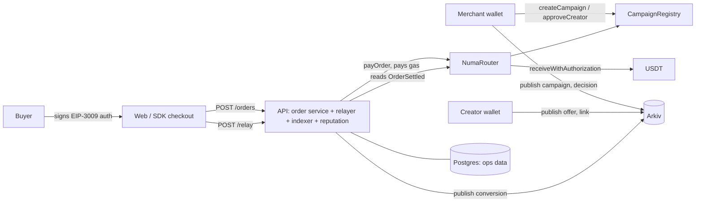

## Campaign lifecycle
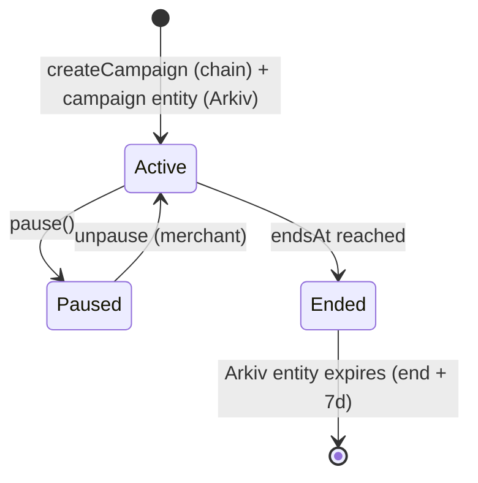

## Offer and approval
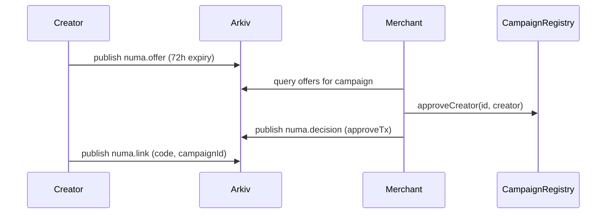

## Buyer checkout and EIP-3009
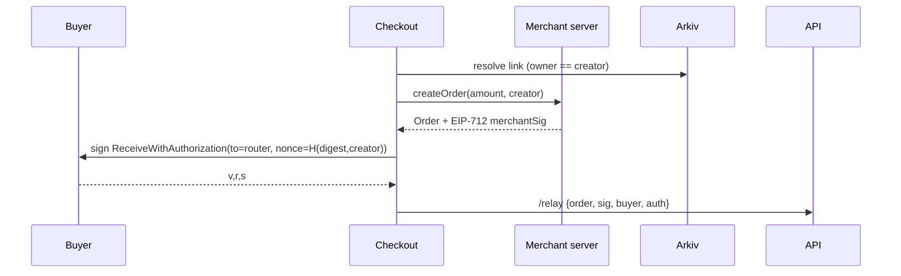

## Relayer submission
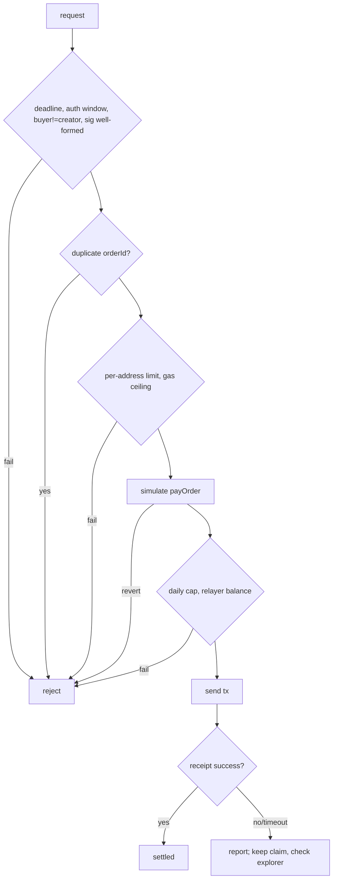

## Payment splitting
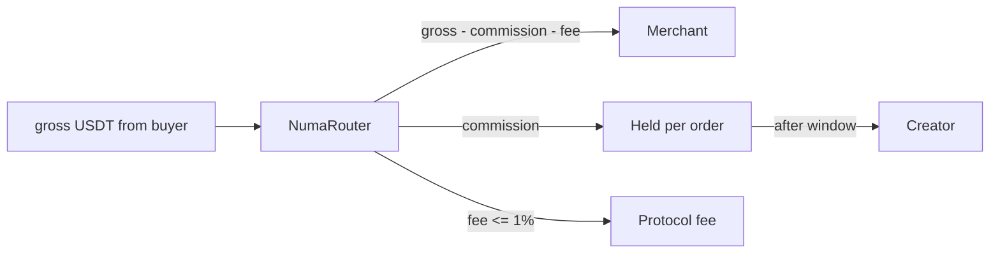
(Merchant payout timing depends on ADR 0001.)

## Refund lifecycle
```mermaid
sequenceDiagram
  participant Me as Merchant
  participant R as NumaRouter
  participant Bu as Buyer
  Me->>R: refund(orderId, X)   (funding per ADR 0001)
  R->>Bu: X USDT
  R->>Me: clawback X*commissionBps/10000 from held
  R-->>R: emit OrderRefunded; held reduced
```

## Commission release
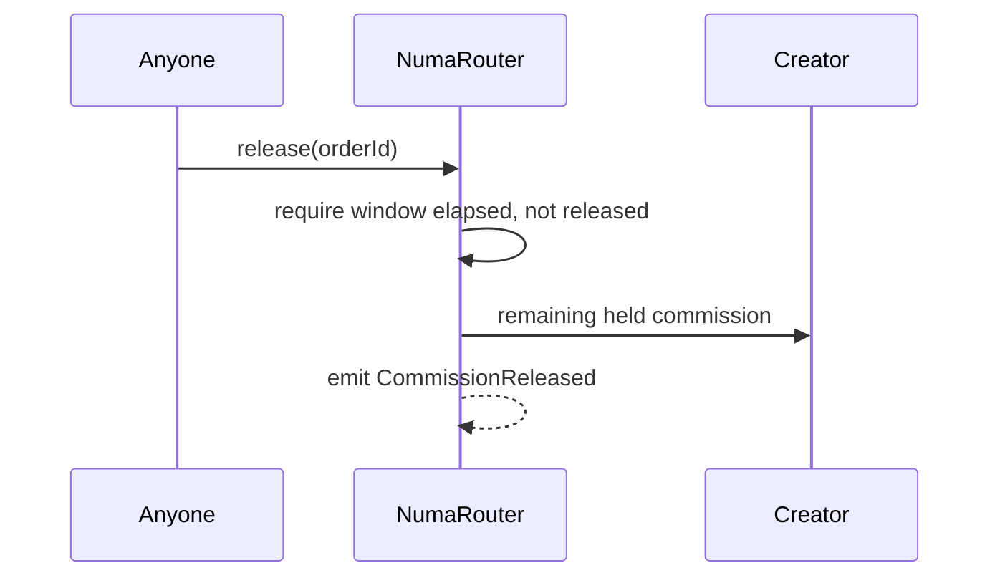

## Arkiv entity ownership
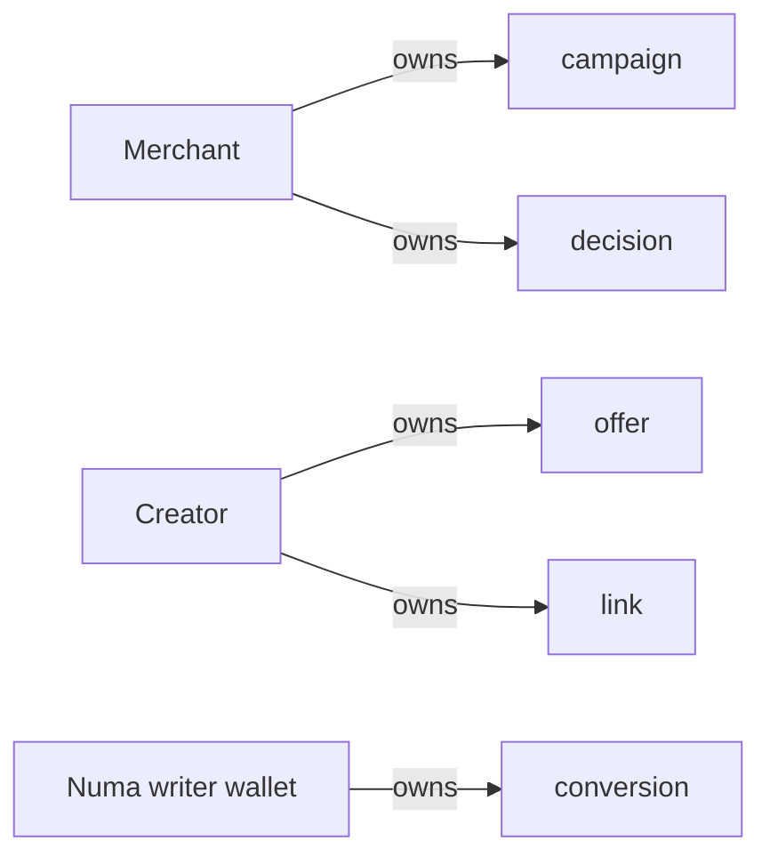

## Reputation verification
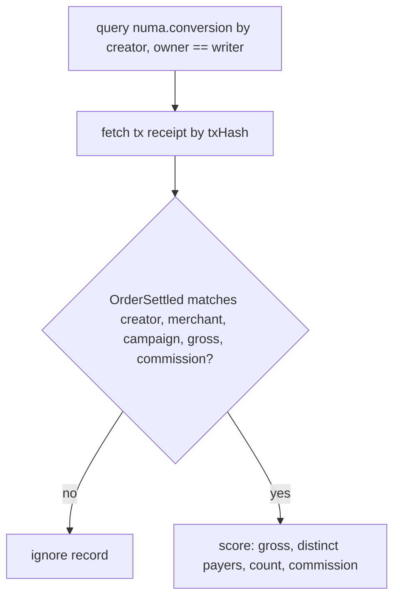

## Creator discovery layer
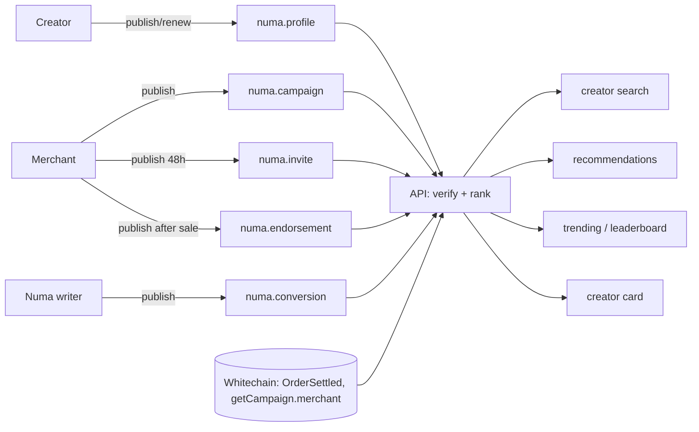

## Negotiation agents (see AGENTS.md, ADR 0008)
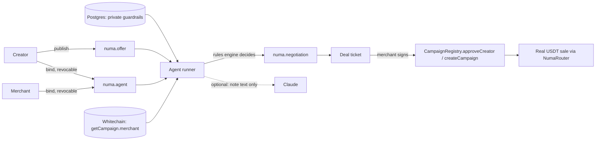
